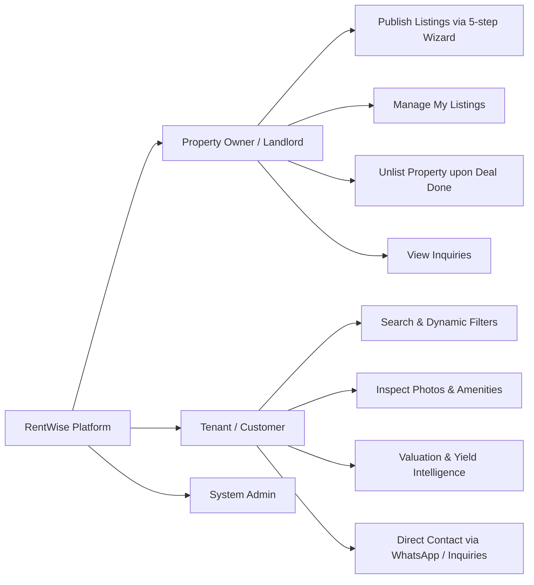
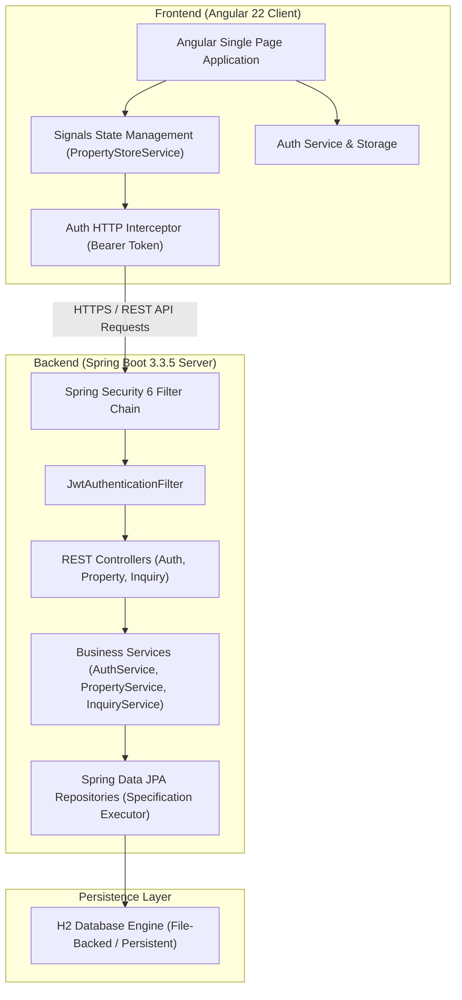
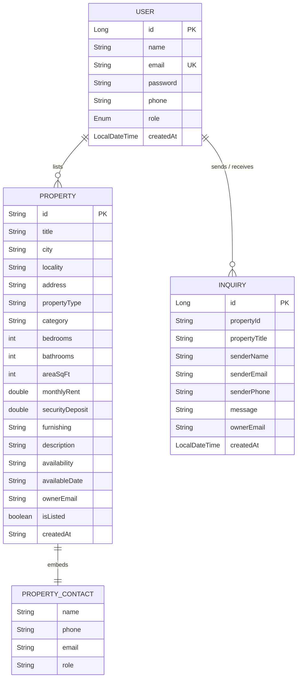

# 📊 RentWise - Complete Project Presentation & PPT Deck

> **Project Name:** RentWise  
> **Tagline:** Direct Peer-to-Peer Rental Property Marketplace  
> **Tech Stack:** Spring Boot 3.3.5 (Java 21/25), Spring Security 6, JWT, Spring Data JPA, H2 Database, Angular 22, TypeScript  
> **Architecture:** Decoupled Client-Server RESTful Architecture  

---

## 📑 Slide-by-Slide Presentation Structure

---

### Slide 1: Title Slide
* **Title:** RentWise: Direct Rental & Flatmate Marketplace
* **Subtitle:** Secure, Zero-Brokerage Property Rental Platform Built with Spring Boot & Angular
* **Presented By:** [Your Name / Team Members]
* **Course / Degree:** [e.g., Computer Engineering / Project Presentation]
* **Academic Year:** 2026

---

### Slide 2: Problem Statement
* **The Challenges in Existing Rental Portals:**
  1. **Heavy Brokerage Costs:** Traditional platforms and real-estate brokers charge 1–2 months of rent just to share contact numbers.
  2. **Unverified & Stale Listings:** Properties remain visible on portals months after being rented out because owners have no easy mechanism to mark a deal as closed.
  3. **Lack of Direct Communication:** Middlemen obstruct direct communication between owners and genuine tenants.
  4. **Complex Onboarding:** Most real-estate platforms have cluttered forms demanding unnecessary legal documents before a basic listing can be posted.
  5. **Security & Session Vulnerabilities:** Unauthenticated inquiries and lack of role segregation between owners and tenants.

---

### Slide 3: Objectives of the Project
* **Primary Objective:** Build a lightweight, high-performance, and intuitive rental marketplace that connects property owners directly with tenants with zero brokerage.
* **Key Sub-Objectives:**
  - **Stateless Authentication:** Implement secure authentication and session management using Spring Security and JSON Web Tokens (JWT).
  - **Role-Based Architecture:** Explicit segregation between **Property Owners** (who list and manage properties) and **Tenants/Renters** (who search and contact owners).
  - **Streamlined 5-Step Listing Wizard:** Enable owners to publish properties with minimal essential details (title, photos, rent, deposit, furnishing, amenities, contact).
  - **Deal Done & Unlisting Lifecycle:** Empower owners to unlist/delete their property listing with a single click once a deal is struck, preventing stale listings.
  - **Integrated Lead & Inquiry Management:** Capture tenant inquiries in the backend database while supporting 1-click WhatsApp and Email communication.

---

### Slide 4: Target Users & Roles

* **1. Property Owner (Landlord / Flatmate):**
  - Registers as `ROLE_OWNER`.
  - Publishes rental homes, private rooms, or shared flats.
  - Maintains full control over listings with unlist/delete capabilities.
* **2. Tenant / Renter (Customer):**
  - Registers as `ROLE_TENANT`.
  - Searches listings by city, locality, budget range, and room types.
  - Submits direct inquiries and contacts owners directly.
* **3. Administrator:**
  - Platform oversight, moderation, and system diagnostics.

---

### Slide 5: System Architecture

---

### Slide 6: Technology Stack Breakdown

| Layer | Technologies Used | Key Purpose |
| :--- | :--- | :--- |
| **Frontend** | Angular 22, TypeScript, RxJS, HTML5, Vanilla CSS | Responsive SPA, Reactive UI with Angular Signals & standalone components |
| **Backend** | Spring Boot 3.3.5, Java 21 / Java 25 | RESTful Web Services, business logic, dependency injection |
| **Security** | Spring Security 6, JJWT 0.12.6, BCrypt | Stateless JWT authentication, role authorization, encrypted passwords |
| **ORM / Data** | Spring Data JPA, Hibernate ORM 6.5 | Object-Relational Mapping, dynamic Specifications query execution |
| **Database** | H2 Embedded Database (`./data/rentwisedb`) | High-speed, zero external installation barrier, file-backed data persistence |
| **API Docs** | SpringDoc OpenAPI 3 / Swagger UI | Live interactive testing interface for evaluators & developers |
| **Build Tools** | Apache Maven 3.9, Node.js / NPM | Automated compilation, packaging, and dependency management |

---

### Slide 7: Key Features & Functional Modules

#### 1. Authentication & Security Module:
* User registration with role selection (`Owner` vs `Tenant`).
* Secure JWT token generation with 24-hour validity and claims payload (`sub`, `role`, `exp`).
* Automatic token injection on every outgoing request via Angular HTTP Interceptor.
* Password hashing using **BCrypt** with salt rounds.

#### 2. Property Exploration & Smart Filtering Module:
* Multi-criteria filtering: **City** (Pune, Mumbai, Bangalore, Delhi NCR, Hyderabad), **Locality**, **Property Type**, **Budget Slider**, **Bedrooms**, and **Furnishing Status**.
* Dynamic JPA query builder utilizing `JpaSpecificationExecutor` for fast SQL querying.
* Sorting by *Recommended*, *Price: Low to High*, *Price: High to Low*, and *Newest First*.

#### 3. 5-Step Property Listing Wizard:
* **Step 1:** Basic Details (Title, City, Locality, Property Type, Bedrooms, Bathrooms, Area, Description).
* **Step 2:** Commercial Terms (Monthly Rent, Security Deposit, Furnishing, Availability).
* **Step 3:** Amenities Multi-select (Wi-Fi, Air Conditioning, Covered Parking, Lift, Gym, etc.).
* **Step 4:** Contact details (Auto-populated with authenticated owner's profile).
* **Step 5:** Review & Instant Publication to live marketplace.

#### 4. Deal Done & Unlisting Lifecycle:
* As requested in the core project requirements: Once a deal is finalized, the property owner can click **"Deal Done? Unlist Listing"**.
* Authenticated `DELETE /api/v1/properties/{id}` endpoint verifies ownership and removes the listing from the active marketplace immediately.

#### 5. Direct Owner-Tenant Communication:
* Direct WhatsApp integration (`https://wa.me/` link with pre-filled property context).
* Direct Email launcher (`mailto:`).
* In-app inquiry form capturing customer details and message in the backend database (`POST /api/v1/inquiries`).

---

### Slide 8: Database Entity Design & Data Model

---

### Slide 9: End-to-End User Journey (Presentation Flow)

1. **Step 1 - Tenant Discovery:**
   - Prospective tenant opens `http://localhost:4200`.
   - Filters Pune properties under ₹30,000/month.
   - Opens property card for *"Spacious 2 BHK Garden Facing Apartment"*.
   - Reviews rent (₹26,000), security deposit, amenities, and photo gallery.
2. **Step 2 - Inquiry Submission:**
   - Tenant clicks *"Contact Owner"*.
   - Submits inquiry: *"Hi, I am interested in viewing this weekend."*
   - Backend saves inquiry under owner's account; tenant gets instant confirmation.
3. **Step 3 - Owner Login & Listing:**
   - Landlord logs in using `owner@rentwise.com` (1-click test button).
   - JWT token is issued; navbar displays owner badge: **`Sunita Kulkarni (Owner)`**.
   - Clicks *"+ List Your Property"*, enters minimal property details, and publishes.
4. **Step 4 - Deal Completed & Unlisting:**
   - Tenant and Owner finalize rental agreement.
   - Owner opens their property details dialog.
   - Clicks **"Deal Done? Unlist Listing"**.
   - Backend executes deletion; listing disappears from the marketplace.

---

### Slide 10: Future Scope & Enhancements (What's Next)

1. **Online Digital Rental Agreements:** Digital e-sign integration (Aadhaar e-Sign) to generate legal rental contracts directly on the website.
2. **Integrated Payment Gateway:** Razorpay / Stripe integration for online token security deposit transfers and automated monthly rent collection.
3. **AI-Powered Fair Rent Valuation:** Machine learning model predicting optimal rent based on locality price indices, amenities, and inflation.
4. **Virtual 360° Tours:** Embedding Matterport or panoramic photo viewers for virtual walkthroughs.
5. **Real-Time WebSockets Chat:** In-app real-time messaging between prospective tenants and owners without sharing phone numbers initially.

---

### Slide 11: Conclusion
* **Summary:** RentWise successfully bridges the gap between property owners and prospective tenants by providing a secure, direct, and zero-brokerage rental platform.
* **Key Achievements:**
  - Robust Spring Boot backend with clean layered architecture (Controller, Service, Repository).
  - Production-ready Spring Security 6 with stateless JWT authentication.
  - Reactive, modern Angular 22 Single Page Application.
  - Comprehensive live API documentation via Swagger OpenAPI.
  - Solved the stale listing problem through the owner **"Deal Done / Unlist"** workflow.

---

### Slide 12: Q & A (Anticipated Viva / Examiner Questions)

* **Q1: Why did you choose JWT over traditional HTTP Sessions?**
  - *Answer:* JWT allows a stateless backend architecture. The server does not need to store session states in memory, allowing horizontal scaling and cross-platform mobile/web consumption without session affinity issues.
* **Q2: Why use H2 database instead of MySQL?**
  - *Answer:* H2 was configured in file-backed persistent mode (`./data/rentwisedb`). It provides complete zero-configuration portability for presentation and evaluation without needing external database server installation, while supporting standard SQL and JPA dialect. Switching to PostgreSQL or MySQL requires only changing 2 lines in `application.properties`.
* **Q3: How do you prevent an unauthorized user from deleting someone else's listing?**
  - *Answer:* In `PropertyService.java`, the `deleteProperty()` method compares the authenticated user's email extracted from the verified JWT against the property's `ownerEmail`. If they don't match, a `SecurityException` (HTTP 403) is raised.
